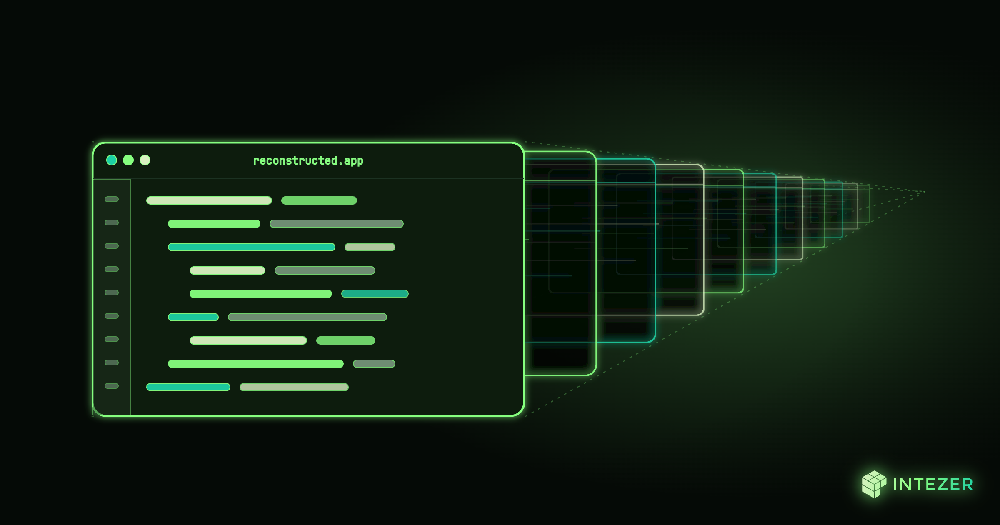
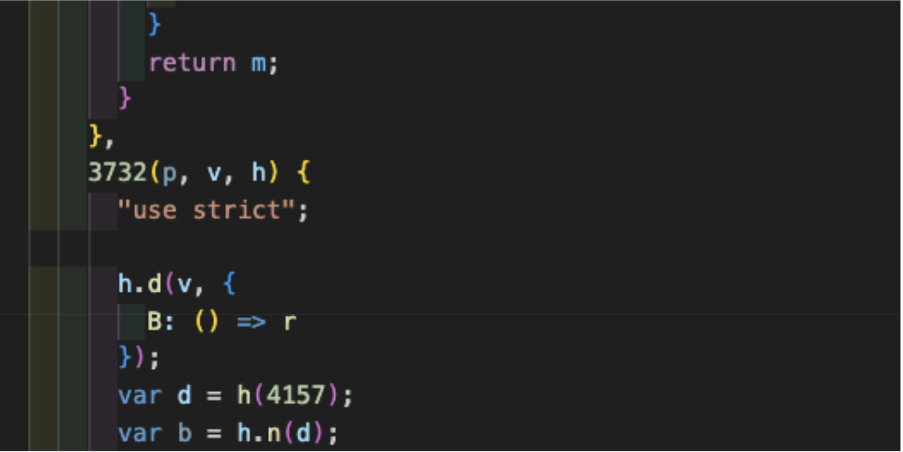
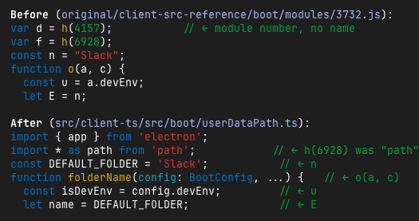
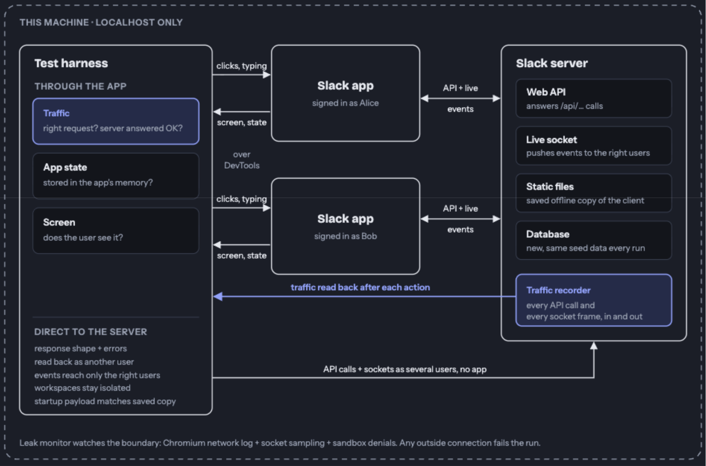
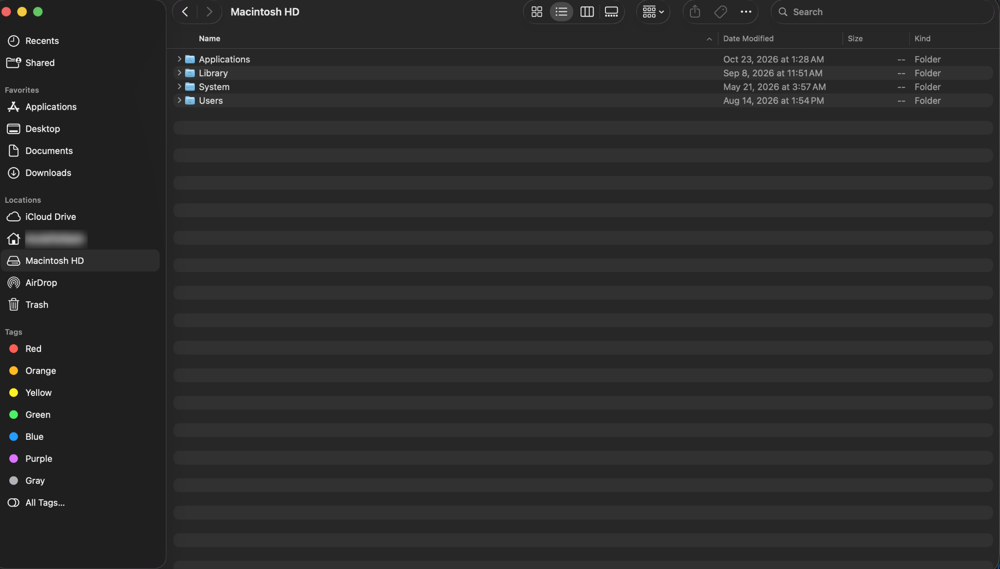
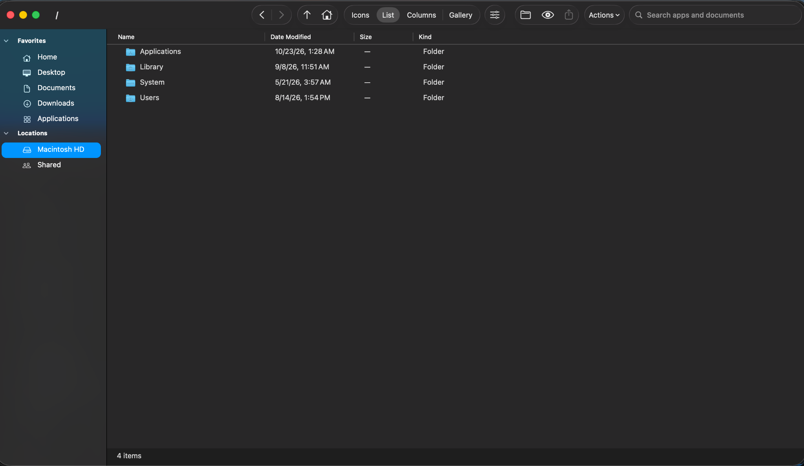

# When Everything Becomes Open-Source

> AI agents rebuilt maintainable source code for Slack, Apple’s Finder and the TinyTurla-NG backdoor from binaries alone. Compiled code no longer hides source.

- Source: https://research.intezer.com/blog/2026/11/when-everything-becomes-open-source/
- Published: 2026-11-10
- Authors: Nicole Fishbein
- Tags: ai, llm, macos, windows, backdoor, apt_russia
- Attribution: Intezer's Research Team (Intezer Research, https://research.intezer.com/)

*This article is based on joint research with the Senior Security Researcher [Eran Segal](https://www.kodemsecurity.com/resources/when-everything-becomes-open-source).*

## Reconstructing Apple, Slack, and even malware source code and adding the features you always wanted 

We live in a world where software applications surround us: browsers, text editors, phone apps, and more. So it is not surprising that companies like Microsoft and Google have billions in market share, and one of their big asset is their product: their software, their code. This makes the product's source code its most valuable asset. These products must be shipped to customers as container images, executables, and APIs. These formats are lossy and cannot be converted back to maintainable source code. This raises the question: how easy is it to convert these assets, using the vendor’s documentation, back into source code we can maintain on GitHub? 

Reverse engineering is an old concept. It is the process of deconstructing a finished product, usually focusing on a specific area that takes humans a long time to analyze. With AI agents, we can do this very fast at a small scale (with an unlimited number of tokens, the sky is the limit). 

For real-world scale, we chose 3 examples that, to the best of our knowledge, AI was never trained on and never saw in its source code. Each app tests different use cases and challenges.

* [Finder](https://support.apple.com/en-gb/guide/mac-help/mchlp2605/mac) \- one of the most used utilities on a Mac computer. This application lets users view and search files on the computer. While the functionality is simple, the file itself is relatively big and complex.  
* [Slack](https://slack.com/) \- a digital messaging app for businesses. Slack client is written in TypeScript, and it is Electron-based, unlike the Slack server, which is not downloadable. Therefore, it requires reconstruction based only on the limited data available.   
* [TinyTurla](https://attack.mitre.org/software/S0668/) Malware \- a well-known second-stage backdoor attributed by [Cisco Talos](https://blog.talosintelligence.com/tinyturla/) to the Turla group. This case tests our ability to reconstruct malicious code and bypass LLM resistance. Source code is easier to inspect than assembly. That is the entire premise. If security teams could produce a faithful reconstruction of a malware sample's source from the compiled file alone, they could read a threat rather than decode it, and they would get there faster.

Our research shows that an AI agent can reconstruct a working copy of an application when given the original software's binary or package. The dataset included different types of applications; the process wasn't smooth, but the results show it is possible. In a world where new and improved agents are released every month, each more capable than the last, it is only a matter of time before these agents can rebuild more complex applications.

> [!WARNING] Disclaimer
> This research was conducted **solely for security research and educational purposes**, in an isolated lab environment. We do not share, distribute or commercially use any reconstructed source code, binaries or other materials. The malware sample was analyzed statically and was never executed. Nothing in this post is intended to encourage reconstructing, modifying or redistributing third-party software in breach of its license terms or applicable law. Apple, Finder, macOS and Slack are trademarks of their respective owners; Intezer and Kodem Security are not affiliated with, sponsored or endorsed by them.

## Technical Details

### The definition of successful reconstruction:

* The code is fully **maintainable and readable**, so we can add new features to the app, fix bugs, and we have the infrastructure to execute everything.   
* The code is clean and idiomatic, comparable in readability to human-written source code  
* The real app and our reconstructed app behave exactly the same. Unlike [Adobe reconstruction](https://medium.com/@YousfiAymane/one-developer-rebuilt-adobes-entire-suite-for-free-using-ai-here-s-what-actually-happened-cc552f71d36e), which behaves similarly   
* We compiled the reconstructed app only from our source.   
* Package dependencies are detected and treated accordingly. No 3rd-party libraries in our source code.

They used to say that if you could read assembly language, any software was open source. But with the new AI models, you might not even need to know assembly. Well, to some extent. For now.

## Case 1: Slack \- difficulty level: medium

Slack is a very famous instant messaging app owned by Salesforce, which acquired Slack in 2021 for \$27.7 billion. Our goal is to prove that we’re able to rebuild the entire Slack app, including the client and the server, so we end up with a fully working Slack environment that we can run and extend in our lab. Slack server is not publicly available therefore, we do not have any source code for it, unlike the Slack client, therefore the reconstruction of these 2 parts is totally different.   
We’ll go over the steps required to reproduce the app. It is worth mentioning that in our lab the reconstruction of the server and the client with the tests was developed in parallel and not sequentially as mentioned here.

### Reconstruction of Slack client

Slack app is written in TypeScript over the Electron framework and uses the React frameworks, both technologies are highly common frameworks used widely throughout the world. The Slack client contains over 500,000 functions, most are 3rd-party libraries and some of them were provided by the Slack server. Therefore, we could offload most of the initial inspection to these tools. Initially, we extracted the app using the [Asar](https://github.com/electron/asar) tool, and we gained a directory of minimized JavaScript files and related artifacts. That code is still written in one long line, and it is impossible to read anything from it, even for an LLM.  Using [webcrack](https://github.com/j4k0xb/webcrack) to unminimize the code and make it much more readable, we fixed the alignment so it will look as shown below.  
  
The pattern of a function with a name containing only digits with 3 parameters is repeated throughout the entire fileset. The content of each function is a different module, so by splitting the huge files according to that pattern, we can separate the huge JavaScript files into the real files similar to the way they are defined in Slack source to keep the architecture.

At this stage, most of the code is not Slack code at all, it is a 3rd-party library Slack is using. Therefore, we let Claude do a deep dive into the minimized code and find all the 3rd-party libraries, some are easy to find because they were originally found in *node\_modules* dir, but some were hidden inside the source code itself. For that, we wrote a script to find indications of npm modules inside other files, and Claude also looked manually for additional insights. 

This phase was ready for heavy AI lifting, converting each JS file to source code like.   
  
From this point, we have the code, but it is not executable, so all we need to do is download all 3rd-party libraries and to make this code work exactly the same way Slack is working.   
It is worth mentioning that lots of the code the Slack client uses is pulled in at runtime from the Slack server, this will be covered in the reconstruction of the Slack server. 

### Reconstruction of Slack Server 

Unlike the Slack client, for reconstruction of the server, we do not have the binary/JS of the server.  
This means that implementing a server that will behave exactly the same as the original Slack server is very hard or even impossible, but building a Slack compatible server is very possible. 

By inspecting the Slack client code and detecting all the APIs statically, along with the ability to do network inspection on a real Slack application and the Slack documentation such as [Slack references](https://docs.slack.dev/reference/methods/), we have clear definitions for the APIs required to be implemented. 

The APIs can be split into 2 parts: 

* Static URLs   
* Restful API/websockets

Static URLs were downloaded from Slack servers, and the resources that required rewriting were done in a similar way as described in the reconstruction of the Slack client. 

In order to implement RESTful APIs were implemented based on the Slack client and matching its behavior to the expected behavior, by inspecting warning logs, errors and additional signals on the client.   
Our Slack server is using an SQLite DB and a relatively simple schema, the minimum possible to provide a proof of concept. 

### Building end-to-end tests 

To execute multiple instances of Slack on the same computer and to being able to communicate with a server found in a different URLs other than Slack original real servers, there were a few patches required to be done in the client, first where to store the files, execute Slack with flags to use different URLs, after these patches we were able to connect the client to the server.

In order to do automation end to end, we need to be able to control the Slack client. In order to do so, we used [Chrome devTools protocol(CDP)](https://chromedevtools.github.io/devtools-protocol/). Using this interface, code was able to locate buttons on the interface and click them/inject text, and do all kinds of operations on the Slack client and validate this behavior.  
   
A mock server was used to capture all the traffic between the client and the server to be able to detect if the traffic has changed.

### Adding feature \- Adding AI auto-complete for Slack 

The goal of the feature is to provide a proof of concept that the infrastructure we developed in the previous steps is good enough for us to be able to develop a full feature Slack doesn’t have (yet)   
In this feature, we’ll add auto-complete text, similar to the auto-complete IDEs have with AI.   
In one short session of Claude, Claude managed to add this feature, which includes connecting Slack server to an LLM server (qwen2.5:3b for ultra-fast results), and exposing an API for auto-completing text, and changes in the Slack client \- to change the behavior of the text in the text box, key binding, new API to handle. 

[YouTube video](https://www.youtube.com/watch?v=DPTmFycLIsg)

*Video: Claude adding AI auto-complete to the reconstructed Slack client and server.*

### Slack Summary 

We were able to reproduce the entire Slack app very simply because it was written in high-level language which contains lots of references and names that existed in the source code, and the transformation between the Slack app to source was relatively trivial. Implementing the server, on the other hand, was more complex because the details of the implementation weren’t shared with us. But building new features such as the auto-complete was simple, as if it were source code.

## Case 2: Finder \- difficulty level: Low-Medium

In this case, we tried to reconstruct the [Finder](https://en.wikipedia.org/wiki/Finder_\(software\)) app. The bundle includes a 25.8 MB executable for Intel and Apple Silicon, along with interface files, images, localized text, and metadata. 

### How the reforging process works 

The reconstruction harness used the code and files from the provided Finder app and processed one feature at a time. For example, when working on the feature of adding a file, first the harness inspects the supplied interface files and executable to identify visible controls and the code paths they call. Then the harness implements the action, tests it, and records anything the available evidence cannot settle. 

In some cases, the provided files can’t reveal how Finder implements a task because it relies on other macOS applications and services, such as cloud-shred files. In those cases, the harness builds a working version using public macOS APIs, tests it, and documents how the behavior might differ.

A separate testing flow creates temporary folders, files, and drivers to test the code of the reconstructed application. The tests cover different Finder features and actions the user can perform.

* Browsing files: opening folders, navigation, selections, sorting on different values, choosing views (such as Gallery view), etc.  
* Working with files: actions such as copy, move, rename, duplicate, tags, and undo. The tests also cover missing files, conflicting names, and other failure cases.  
* Search feature: search criteria and results, saved Reforge searches, Get Info, previews, and preference controls.

### Current state and remaining differences 

The Finder binary contains tens of thousands of function views across two architectures, with dynamic Objective-C calls and extensive framework and private-service dependencies. That makes it hard to map every original function to a rebuilt counterpart or use a whole-binary similarity score to measure progress. Instead, we use static analysis in the harness to establish specific facts about the original, build user-facing workflows with public macOS APIs, test those workflows, and record where the original behavior remains unknown.

The reconstructed app supports many everyday local-file workflows, including browsing, windows and tabs, common file actions, local search, Get Info, tags, Quick Look, and preferences. The reconstruction uses public macOS APIs for features that couldn't be implemented solely from the provided files. As a result, its internal size and structure are expected to differ from Apple’s Finder. The remaining gap comes from features that involve files managed by cloud services, such as online-only files and sync status, or actions whose results depend on other macOS services.

## Case 3: TinyTurla \- difficulty level: hard

Malware makes this difficult. Even small samples are typically stripped C or C++ binaries with no symbols, comments, or file boundaries. Reconstruction must recover the whole program: its functions, data structures, control flow, and behavior. Success means a source tree that compiles and matches the original binary. That is already expensive in time and tokens before obfuscation or packing enters the picture.

We wanted to know whether a strict workflow could clear that bar, and whether the result could be defended with evidence rather than asserted with confidence.

### The Target: A TinyTurla-NG DLL

The input is a TinyTurla-NG x64 Windows DLL of 291,840 bytes, built with MSVC linker 14.29 and carrying a compile timestamp of December 22nd, 2023\. Binary Ninja resolves 1,041 functions in it. The sample is unpacked and unobfuscated.

The goal was never to recover the author’s exact source text. Comments, formatting, and most variable names are gone the moment a binary is compiled. The deliverable is something different: a new, evidence-backed implementation that behaves like the binary and can be shown to do so.

### The Rules

First, the binary is the source of truth. A language model may propose an interpretation, but it cannot certify one. Every conclusion is tied to static evidence. Second, nothing is ever executed. Neither the original nor the rebuilt binary is ever run.

The reconstruction evaluates two separate goals, and it keeps them separate on purpose:

* Behavioral equivalence: matching control flow, calls, data effects, cleanup, error paths, and ABI behavior.  
* Structural similarity: matching functions, control-flow graph, call relationships, and machine-code shape, measured with BinExport and BinDiff.

### The Setup

In this reconstruction harness, no single model does every step. It is a deterministic Python control plane wrapped around static-analysis tools, a compiler, and several bounded language-model roles. The models are components inside the system, not the system itself.

Binary Ninja performs static analysis of the original binary locally and produces the gold-standard database (the `.bndb` file). It supplies the authoritative disassembly, IL, and decompiler output that every downstream step consumes. Binary Ninja output is the static ground truth for the whole project. Once the harness has a reconstructed function, it compares that function's High Level Intermediate Language ([HLIL](https://docs.binary.ninja/dev/bnil-hlil.html)) against the corresponding function in the original file using the same tool.

A Windows VM compiles the reconstructed C++. The machine where Codex runs connects to the Windows VM via SSH. [Codex](https://openai.com/codex/) extracted the compiler version from the binary and installed the closest compilation toolchain on the Windows VM. It is not a perfect match, and the reason becomes important later: the original binary appears to include objects produced by an unavailable pre-release compiler around build 27412\.

Codex, configured to use GPT-5.6-sol-high, operates the workflow: it inspects artifacts, makes engineering decisions, integrates code, investigates failed gates and build errors, and invokes the tools. Inside the harness, Kimi K3 hosted on Fireworks fills three isolated roles.

Two operational guardrails are worth naming. It sends only selected static evidence to Kimi K3. Binaries and credentials are never uploaded, and during equivalence review, the reconstructed source passes through a dedicated redaction path that strips string-literal contents before transmission. Separately, every request is recorded in a budget ledger that must preserve a mandatory five-dollar reserve under the authorized spending ceiling, so the workflow cannot burn resources without accountability.

### What Was Reconstructed

The project produced a complete, compiling C++ implementation of the TinyTurla-NG DLL from static analysis alone.

| Measure | Original | Reconstruction |
| :---- | :---- | :---- |
| File size | 291,840 bytes | 296,960 bytes |
| Functions | 1,041 | 1,072 |
| Imported symbols | Identical | Identical |

BinDiff pairs 1,034 of the original functions and reports 92.8% whole-program similarity at 98.7% confidence. That is a statement about shape, not about behavior. The behavioral case compares the original and rebuilt functions one at a time, at the right addresses.

The reconstructed code fits in two source files, about 3,100 lines in total. Together they cover the implant’s full working pipeline: registering with its C2 servers, receiving and executing commands, running shell commands, transferring files, and removing itself. One deliberate omission: we did not hand-write the Microsoft C++ runtime. Where the evidence showed a function came from the compiler’s libraries, the rebuild simply links them. Writing plausible-looking source for that code would have inflated the numbers while making the result less honest.

 comparison of the same function. On the left is the reconstructed source code, and on the right is the decompilation of the original file in Binary Ninja.")

## How to protect your software? 

This research shows that AI agents can reconstruct real-world applications and gain the application source code. It also shows that obstacles remain, and the workflow is not smooth or perfect. Yet. Another thing to consider is that while someone can vibe-code applications like Slack, it will be much harder to build the infrastructure needed to run them.

We learned that clear objectives make the process harder for an AI to solve. When there is no clear guidance on how things in the application work, documentation is lacking, metadata is not useful or clear, and the code is low-level, all of these add a lot of complexity. Would more tokens, more capable models, and better harnesses fix this? Maybe\! But in the meantime, if software providers use encryptors and obfuscators- tools used for years to prevent people from hacking applications (such as anti-cheating software for computer games)- these will make the process much harder for AI agents and raise the bar.

What would be the impact of converting every software to an open-source application? How would it affect the global economy?  AI is clearly changing our industry and our world. While it's still unclear how it will affect our jobs and lives in the future, this research shows that AI will significantly affect a new aspect. The software industry will have to adjust.
